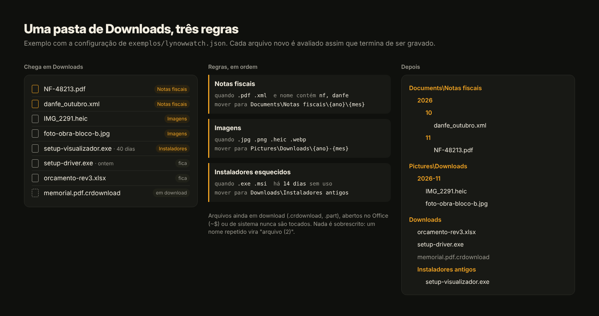
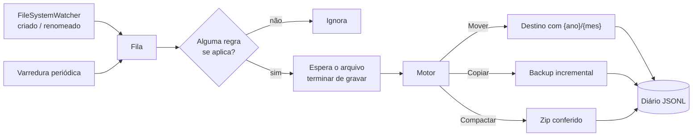

<p align="center"><sub>LynowWatch</sub></p>

---

<p align="center">
  
</p>

<p align="center">
  Diga uma vez para onde cada arquivo deve ir. O LynowWatch fica de olho nas pastas e organiza, copia ou compacta sozinho.
</p>

<p align="center">
  <a href="https://github.com/arthurlynow098/LynowWatch/releases"></a>
  
  
</p>

> [!IMPORTANT]
> O pacote para Windows é gerado pelo GitHub Actions e publicado em **[Releases](https://github.com/arthurlynow098/LynowWatch/releases)** a cada versão marcada. Antes de instalar o serviço, rode `LynowWatch simular`, ele mostra tudo o que seria feito sem mexer em nenhum arquivo.

## Sobre o projeto

A pasta Downloads vira um depósito, nota fiscal misturada com foto da obra, instalador de três meses atrás, planilha que alguém mandou por e-mail. Em pastas de projeto o problema é outro, o desenho mais recente precisa de cópia no backup e as exportações pesadas ocupam o disco por anos.

O LynowWatch é um serviço do Windows que observa as pastas que você escolher e aplica regras simples, **quando** o arquivo tem tal extensão, nome, tamanho ou idade, **mover**, **copiar** ou **compactar** para um destino que pode usar o ano, o mês ou a subpasta de origem. Ele espera o arquivo terminar de ser gravado, nunca sobrescreve sem você pedir, ignora downloads em andamento e arquivos abertos no Office, e registra cada ação em um diário que pode ser consultado depois.

<p align="center">
  
</p>

## Principais recursos

| Recurso | Como funciona |
|---|---|
| Três ações | **Mover** para organizar, **Copiar** para backup e **Compactar** para arquivar em `.zip`. |
| Condições combináveis | Extensão, curingas no nome (`NF-*.pdf`), trechos do nome, tamanho mínimo e máximo e dias sem alteração. |
| Destinos com marcadores | `{ano}`, `{mes}`, `{dia}`, `{ext}`, `{nome}`, `{relativo}` e `{pasta}`, além de `%USERPROFILE%` e outras variáveis. |
| Espera o arquivo assentar | Só age quando o tamanho para de mudar e o arquivo pode ser aberto sem outro programa usando. |
| Sem perda de dados | Conflitos viram "arquivo (2)" por padrão. O zip é conferido antes de o original ser removido. |
| Backup incremental | Ao copiar, pula arquivos cujo destino já tem o mesmo tamanho e a mesma data. |
| Simulação | `LynowWatch simular` lista o que aconteceria com cada arquivo, sem alterar nada. |
| Proteção contra ciclos | A configuração é recusada se um destino ficar dentro de uma pasta monitorada com subpastas. |
| Diário de ações | Cada ação vai para um arquivo JSON Lines com data, regra, origem, destino e resultado. |
| Recuperação | Uma varredura periódica cobre eventos perdidos e regras por idade, mesmo depois de o PC ficar desligado. |

## Tecnologias

<p>
  
  
  
  
  
  
  
</p>

### Serviço

- **.NET 8 Worker Service** com `Microsoft.Extensions.Hosting.WindowsServices`, instalado como serviço automático
- **FileSystemWatcher** por pasta, com eventos enfileirados em um `Channel` limitado
- processamento paralelo controlado por `SemaphoreSlim` e deduplicação de eventos repetidos
- `PeriodicTimer` para a varredura completa.

### Núcleo

- biblioteca `LynowWatch.Core` sem dependências externas, testável com pastas temporárias
- configuração em **JSON** com comentários, lida por `System.Text.Json`
- **System.IO.Compression** para os arquivos `.zip`.

### Distribuição

- `dotnet publish` em executável único `win-x64`, sem exigir o .NET instalado
- scripts **PowerShell** para instalar e remover o serviço com reinício automático em caso de falha
- **GitHub Actions** roda os testes no Windows e publica o pacote em Releases.

## Arquitetura



O serviço só cuida de eventos, fila e paralelismo. Quem decide e executa é o `Motor`, do núcleo, escolhe a primeira regra que combina, calcula o destino, resolve conflitos e devolve um `Resultado`. Os comandos `simular` e `executar` usam exatamente o mesmo motor.

## Configuração

O arquivo fica em `%ProgramData%\LynowWatch\lynowwatch.json`. Um exemplo completo está em [`exemplos/lynowwatch.json`](exemplos/lynowwatch.json)

```jsonc
{
  "Pastas": [
    {
      "Nome": "Downloads",
      "Caminho": "%USERPROFILE%\\Downloads",
      "Regras": [
        {
          "Nome": "Notas fiscais",
          "Quando": { "Extensoes": [".pdf", ".xml"], "NomeContem": ["nf", "danfe"] },
          "Acao": "Mover",
          "Destino": "%USERPROFILE%\\Documents\\Notas fiscais\\{ano}\\{mes}"
        }
      ]
    },
    {
      "Nome": "Projetos",
      "Caminho": "D:\\Projetos",
      "Subpastas": true,
      "Regras": [
        {
          "Nome": "Backup de desenhos",
          "Quando": { "Extensoes": [".dwg", ".dxf"] },
          "Acao": "Copiar",
          "Destino": "E:\\Backup\\Projetos\\{relativo}",
          "Conflito": "Substituir"
        }
      ]
    }
  ]
}
```

| Campo da regra | Valores |
|---|---|
| `Acao` | `Mover`, `Copiar` ou `Compactar` |
| `Conflito` | `Renomear` (padrão), `Ignorar` ou `Substituir` |
| `Quando` | `Extensoes`, `Padroes`, `NomeContem`, `TamanhoMinimoKb`, `TamanhoMaximoKb`, `IdadeMinimaDias` |
| `ApenasSeAlterado` | Para `Copiar`, pula se o destino já está igual (padrão `true`) |
| `ManterOriginal` | Para `Compactar`, mantém o arquivo depois de criar o zip (padrão `false`) |

As datas de `{ano}`, `{mes}` e `{dia}` vêm da última alteração do arquivo, para que uma nota de outubro vá para outubro mesmo se for organizada em novembro.

## Estrutura do repositório

```text
LynowWatch/
├── src/
│   ├── LynowWatch.Core/          Regras, filtros, motor, validação e diário
│   └── LynowWatch/               Serviço do Windows e comandos de linha de comando
├── tests/LynowWatch.Tests/       Testes xUnit com pastas temporárias
├── exemplos/lynowwatch.json      Configuração de exemplo comentada
├── scripts/                      Instalação e remoção do serviço
├── assets/                       Banner, mascote, ícone e ilustração
├── .github/workflows/ci.yml      Testes no Windows, pacote e Releases
└── PRODUTO.md                    Direção do produto e próximos passos
```

## Executando o código

Para rodar você precisa de Windows 10 ou mais recente e .NET 8 SDK.

```powershell
dotnet test
dotnet run --project src/LynowWatch -- verificar --config exemplos/lynowwatch.json
dotnet run --project src/LynowWatch -- simular   --config exemplos/lynowwatch.json
```

Para rodar em primeiro plano, vendo os logs no console

```powershell
dotnet run --project src/LynowWatch -- --config caminho\para\lynowwatch.json
```

### Instalando como serviço

1. Baixe `LynowWatch-Windows-x64.zip` em **[Releases](https://github.com/arthurlynow098/LynowWatch/releases)** e extraia.
2. Abra o PowerShell como administrador na pasta extraída e rode `.\instalar-servico.ps1`.
3. Na primeira vez, o script copia a configuração de exemplo para `%ProgramData%\LynowWatch` e a abre no Bloco de Notas. Ajuste as pastas.
4. Confira com `LynowWatch simular` e rode o script de novo para instalar e iniciar o serviço.
5. Acompanhe com `LynowWatch registro --ultimos 50`.

Para remover `.\remover-servico.ps1`. A configuração e o diário são mantidos.

## Decisões técnicas

- **Núcleo separado do serviço.** Toda a lógica de arquivos roda igual no serviço, na simulação e nos testes.
- **Data do arquivo, não do relógio.** Organizar por `{ano}/{mes}` usa a última alteração, o que mantém a ordem real dos documentos.
- **Renomear por padrão.** Perder um arquivo por sobrescrita é pior do que ter um "(2)" a mais.
- **Planejar antes de esperar.** O serviço só aguarda a estabilidade de arquivos que alguma regra vai mover, evitando abrir milhares de arquivos a cada varredura.
- **Rename como sinal de pronto.** Navegadores baixam como `.crdownload` e renomeiam no fim. O evento de rename dispara o processamento.
- **Validação antes de iniciar.** Marcadores desconhecidos, pastas sobrepostas e destinos que criariam ciclo impedem o serviço de subir, com a mensagem do que corrigir.

## Estado atual

Esta é a versão **0.1.0 alpha**. As três ações, as condições, os marcadores, a simulação, o diário, a validação e a instalação como serviço estão implementados e cobertos por testes do núcleo.

Ainda não há interface gráfica, a configuração é feita no JSON e o acompanhamento pelo comando `registro`. A pasta de destino de `{relativo}` replica a estrutura de origem, mas arquivos apagados na origem não são apagados no backup (não é sincronização espelhada). O executável ainda não tem assinatura de código, então o Windows pode exibir um aviso na primeira execução.

## Documentação

- [Direção do produto](PRODUTO.md)
- [Configuração de exemplo](exemplos/lynowwatch.json)
- [Motor de regras](src/LynowWatch.Core/Motor.cs)
- [Testes](tests/LynowWatch.Tests)
- [Identidade visual do banner](docs/BANNER.md)

## Licença

Distribuído sob a [licença MIT](LICENSE).

---

<p align="center"><sub>Estudo · construção · evolução</sub><br><a href="https://github.com/arthurlynow098">Perfil</a> · <a href="https://arthurentsev.vercel.app/">Portfólio</a></p>

<p align="center"><sub>A gravura do banner é a coruja de Thomas Bewick, em domínio público no <a href="https://commons.wikimedia.org/wiki/File%3ABewick_Thomas_-_Chouette_effraie.png">Wikimedia Commons</a>.</sub></p>
